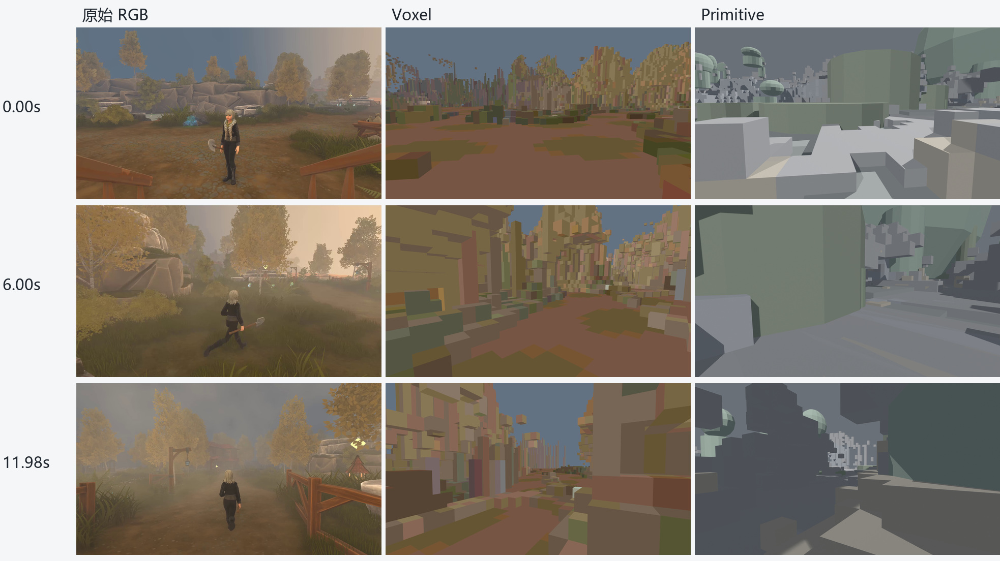
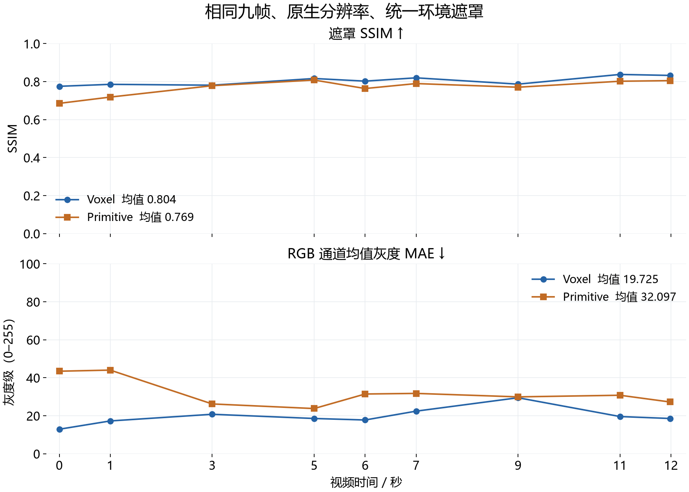
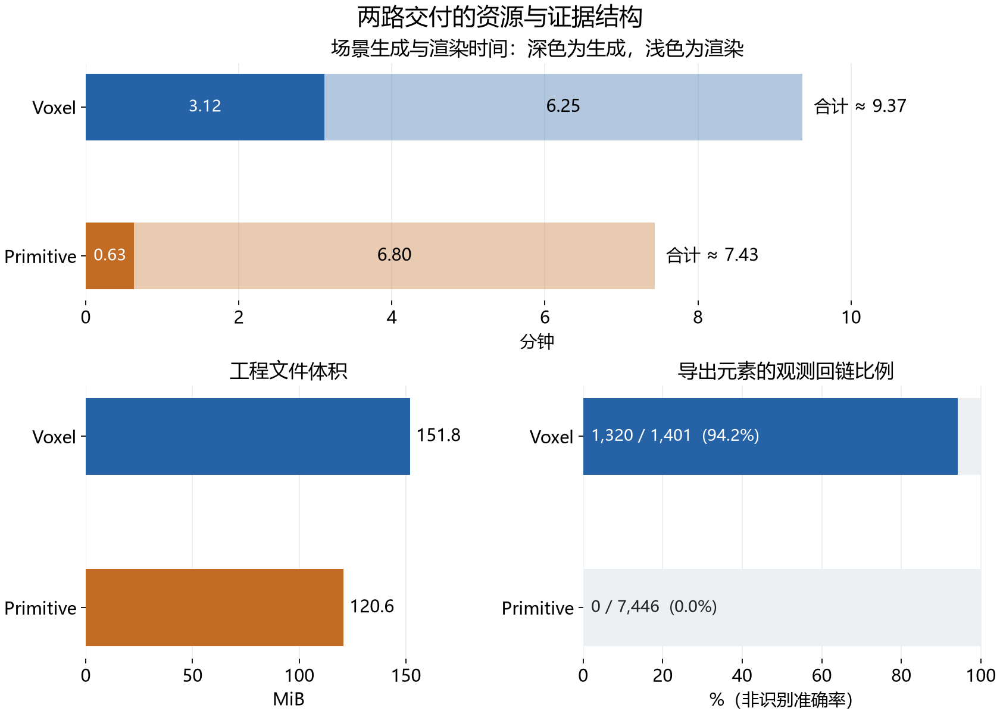

# 游戏录屏的三维粗模重建：Voxel 与 Primitive

面向 10–15 秒游戏录屏，构建语义理解、几何代理、场景生成与质量验证工作流，输出时间轴一致的导演台视频和可编辑 Blender 工程。本项目比较两种互补表达：**Voxel 侧重环境覆盖与镜头可用性；Primitive 侧重类别到基本体的结构化映射与编辑性。**

当前交付为 12 秒环境/镜头粗模。两路均采用启发式几何与推断相机，不包含角色动作代理。

## 1. 实验设置与交付

数据来自 [Origin Lab Game Recordings v4](https://huggingface.co/datasets/originlab/game-recordings-v4)，Session `66ad9535-583f-4a25-b655-6b1697c83a40` 的 `[0, 12)` 秒：1920×1080、60 FPS、720 帧。元数据记录 UE5、地图 `Island`，未提供明确游戏名称。数据准备采用有界前缀下载，不下载完整 Session 或整库。

两路共享原始 RGB/深度码、61 帧 Grounding DINO + SAM 分割缓存、相机校准与 720 帧轨迹；渲染均采用 Blender 5.2.1 LTS / EEVEE。几何补齐、形状先验与材质设置不同，因此属于**同源方案比较，而非单变量消融实验**。

| 交付物 | Voxel：彩色体素 | Primitive：分类基本体 |
| --- | --- | --- |
| 原片 / 粗模对比 | [original_vs_blockout.mp4](outputs/stage_ef/heuristic_voxel_proxy/original_vs_blockout.mp4) | [original_vs_blockout.mp4](outputs/stage_ef/heuristic_primitive_from_video/original_vs_blockout.mp4) |
| 纯粗模视频 | [blockout_video.mp4](outputs/stage_ef/heuristic_voxel_proxy/blockout_video.mp4) | [blockout_video.mp4](outputs/stage_ef/heuristic_primitive_from_video/blockout_video.mp4) |
| 可编辑场景 | [scene.blend](outputs/stage_ef/heuristic_voxel_proxy/scene.blend) | [scene.blend](outputs/stage_ef/heuristic_primitive_from_video/scene.blend) |
| 原始验证记录 | [proxy_run.json](outputs/stage_ef/heuristic_voxel_proxy/proxy_run.json) | [primitive_run.json](outputs/stage_ef/heuristic_primitive_from_video/primitive_run.json) |

### Voxel 对比视频

左侧为原始录屏，右侧为彩色体素粗模。

<video controls muted playsinline preload="metadata" width="100%" poster="docs/figures/voxel_compare_6s.jpg">
  <source src="outputs/stage_ef/heuristic_voxel_proxy/original_vs_blockout.mp4" type="video/mp4">
</video>

### Primitive 对比视频

左侧为原始录屏，右侧为分类基本体粗模。

<video controls muted playsinline preload="metadata" width="100%" poster="docs/figures/primitive_compare_6s.jpg">
  <source src="outputs/stage_ef/heuristic_primitive_from_video/original_vs_blockout.mp4" type="video/mp4">
</video>

不支持内嵌播放器的 Markdown 阅读器可使用交付表中的 MP4 链接。

以下为相同源帧的原始 RGB、Voxel、Primitive；行时间分别为 0、6、11.983 秒。



Voxel 作为当前环境/镜头展示方案；Primitive 用于检查基本体表达与局部编辑。两路均存在物体合并、位置偏差和细节缺失；Primitive 近景仍有大体积遮挡。人物、斧头、木牌及雾效未重建。所有媒体链接依赖本地文件，使用权限见文末。

## 2. 工作流与分支

编排器负责阶段状态、工具执行、缓存、失败记录与质量检查。视觉模型生成预测类别与遮罩；数值模块生成几何；Scene JSON 约束单位、时间、来源和对象结构；Blender 后台创建场景、保存重开并渲染。当前采用规则式编排，未实现 LLM 自主规划或几何修复循环。


Voxel 入口为 `reconstruction.heuristic_proxy`；本次 Primitive 入口为 `reconstruction.primitive_blockout`，直接读取视频观测，**不读取 Voxel 补齐后的占用结果**。历史目录 `heuristic_primitive_proxy/` 为体素派生灰模基线，不属于本次两路比较。

严格米制路径 A → B → C → D → E → F → G 已通过合成端到端验证，并提供 `reviewed` 输入接口。本次真实 Session 因深度逆公式、单位、像素采样和渲染姿态绑定未确认，在 A 返回阻塞，B–F 跳过，G 生成 partial 报告。两条启发式入口及本节离线比较尚未接入统一 A–G CLI。

## 3. 两种表达的技术差异

| 维度 | Voxel | Primitive |
| --- | --- | --- |
| 几何单元 | 0.5 场景单位体素；跨类别剔除内部面，按空间区块导出网格 | 从采样观测点拟合方块、圆柱、球体；保留独立可编辑元素 |
| 几何先验 | 补齐连续地面、环境柱状体积，预留相机自由走廊 | 不执行全局地面补齐或柱体填充；地面分块、树干/树冠及实心区间采用类别规则 |
| 语义表达 | 类别附着于体素及网格区块，侧重空间占用与粗轮廓 | 类别显式关联基本体类型、尺寸与部分父子关系 |
| 观测累计 | 每帧对独立体素投票，至少两个训练帧支持后进入融合；补齐几何另行标注 | 当前 `min_votes` 按采样点数累计，不能等同于两个独立帧支持 |
| 对象标识 | 1,401 个空间/类别区块；不代表 1,401 个真实物体 | 7,446 个拟合元素：7,310 方块、90 圆柱、46 球体；不代表真实实例数 |
| 主要风险 | 补齐先验可能掩盖观测缺失；高覆盖不保证布局正确 | 形状先验可能替代真实轮廓；细碎元素和近景体积影响可读性 |

两路均以推断地面锚定深度码的远近关系，工程虽使用米制设置，真实尺寸尚未认证。两路 `object_id` 均为生成元素标识，不能作为跨帧真实实例身份验证。

## 4. 场景理解能力的验证差异

两路共享视觉模型与预测缓存，比较结果不能用于判断 Grounding DINO / SAM 的识别能力差异。验证应区分视觉识别、语义到几何转换、证据可追溯性及空间可用性。

| 验证层 | Voxel 的可检查内容 | Primitive 的可检查内容 | 当前证据边界 |
| --- | --- | --- | --- |
| 视觉识别 | 预测类别在空间占用中的分布 | 相同预测类别对应的拟合元素 | 模型与缓存相同；无独立实例标注，P/R、Mask IoU 未验收 |
| 语义 → 几何 | 环境体积、粗轮廓、道路/树墙与镜头关系 | 类别—基本体映射、尺寸、树干—树冠分解及父子关系 | Primitive 的表达更显式，但规则映射本身不是识别正确性的证明 |
| 观测回链 | 1,320 / 1,401 区块包含代表观测，共 1,320 条记录 | 0 / 7,446 元素包含逐对象观测；保留全局输入哈希 | Voxel 记录为单帧推断关联，非实例真值；Primitive 为导出回链缺失，非原始观测缺失 |
| 结构关系 | 当前无父子关系 | 46 条树干—树冠父子关系 | 属于拟合规则输出，尚未通过独立结构标注验证 |
| 时序理解 | 静态环境与固定时间轴 | 静态基本体与固定时间轴 | 均未验证角色轨迹、动作事件、遮挡期间身份保持 |

因此，**Voxel 更适合验证空间覆盖与镜头通道，Primitive 更适合暴露语义到结构化几何的转换错误**。当前数据不足以得出任一路径“场景理解准确率更高”的结论。

后续独立验收应采用未参与拟合的实例与事件标注：类别/Mask P/R 与 IoU、对象投影位置与尺寸、部件关系、遮挡顺序、角色身份和动作时刻。最终网格的几何精度应独立于点云评价；不能将源预测遮罩或其投影回链作为真值。

## 5. 统一视觉比较与质量门槛

时间映射固定为 `源帧 i → 视频时间 i/60 秒 → Blender 帧 i+1`，`i=0..719`。每秒起始帧对应 `60s → 60s+1`，`s=0..11`；末帧 PTS 为 11.9833 秒，视频总时长为 12 秒。该映射验证输出时序一致性，不证明推断相机或角色动作准确。

本次重新计算相同九帧：`0, 60, 180, 300, 360, 420, 540, 660, 719`。两路使用同一原生 RGB 和环境遮罩 `0 < codes10 < 1020 且预测类别 ≠ person`；以下均值为九帧指标的算术平均。



| 统一指标 | Voxel | Primitive | 解释 |
| --- | ---: | ---: | --- |
| 遮罩 SSIM ↑ | 0.804 | 0.769 | Gaussian 11×11、σ=1.5，遮罩腐蚀 11×11；不同于 Stage G 的均匀窗口实现 |
| RGB 均值灰度 MAE ↓ | 19.725 | 32.097 | 遮罩内 RGB 通道均值灰度的绝对误差，量程 0–255；非标准加权亮度 |
| 视频长度 / FPS / 帧数 | 12 秒 / 60 / 720 | 12 秒 / 60 / 720 | 原片、粗模与对比片均回读验证全部 PTS |
| 保存重开相机最大矩阵差 | 5.4e-7 | 5.4e-7 | 相机写入/保留误差，非真实位姿估计精度 |
| 真实几何 / 语义准确率 | N/A | N/A | 缺已验证物理合同及独立语义真值，不以零误差替代 |

Voxel 在本样本的图像一致性指标上较优。由于两路材质、几何补齐和形状先验不同，该差异不能单独归因于表示类型，亦不构成语义或几何精度证明。曲线连线仅连接九个采样点，不代表全 720 帧已完成视觉评分。

原始生产门槛并不等价：

| 检查 | Voxel | Primitive |
| --- | --- | --- |
| 相机可用性 | 独立检查全 720 帧占用体素，相机中心入体素帧数为 0；走廊半径 2.5 场景单位 | 拟合阶段过滤近相机基本体；无同口径独立逐帧体素穿模报告 |
| 环境覆盖 | 射线覆盖 95.9%–100%；实际渲染覆盖 96.2%–100% | 未提供同口径覆盖实测；回执中的 `coverage_status=passed` 不作为覆盖测量结果 |
| 预览门槛 | 单帧覆盖 ≥45%、均值 ≥65%、近墙比例 ≤1%，再检查渲染覆盖 | 当前灰度 MAE 32.1 优于历史灰模基线 67.5；该基线不是 Voxel |

覆盖门槛仅用于排除明显不可用候选，不能解释为还原率。历史实体候选即使 SSIM 优于基线，仍因 261 / 720 帧相机在实体内而被拒绝完整渲染。Primitive 当前算法允许缺失灰模基线时通过比较门槛，独立参考与强制验收仍需完善。

合成 G 报告中 CD 0.046 m、5 cm F-score 0.977、观测覆盖 0.956 比较的是融合点云与已知深度表面，不是两路真实粗模网格。合成 SSIM 0.755 亦不与本节遮罩 SSIM 混用。完整定义见 [Stage G](docs/stage_g.md)。

## 6. 资源与成本



| 已记录资源 | Voxel | Primitive |
| --- | ---: | ---: |
| 场景生成时间，约 | 187 秒 | 38 秒 |
| 渲染进程至末帧保存 | 374.953 秒 | 407.985 秒 |
| 生成 + 渲染，约 | 9.37 分钟 | 7.43 分钟 |
| `.blend` 文件体积 | 151.8 MiB | 120.6 MiB |
| 纯粗模 MP4 体积 | 4.60 MiB | 3.99 MiB |
| 导出元素附带观测比例 | 94.2% | 0.0% |

生成耗时来自历史近似记录；渲染耗时取日志中末帧 PNG 保存时的进程累计时间，包含场景读入和验证。以上不包含下载、61 帧识别、相机校准、代理几何生成、九帧预览、编码及人工审核，亦不是受控性能基准。回链比例衡量记录是否存在，不衡量关联正确性。

Primitive 的场景生成与工程体积较低，但渲染未随元素数或生成耗时同比下降。成本应按完整任务和合格交付统计，而非仅按渲染或模型 API 计费。

```text
单条合格视频成本 = 总投入 / 合格交付数
总投入 = 计算机时 × 单价 + 存储/传输 + 人工审核/修正 + 开发/模型准备摊销
计算与人工投入包含失败尝试和重试
```

本次视觉识别在 RTX 4070 本地执行，无视频生成或 VLM API 调用，远程模型调用费用为 ¥0。若假设等效机器 ¥20/小时且速度一致，仅上述生成与渲染成本约为 **Voxel ¥3.12、Primitive ¥2.48**；该值为条件估算，不是云报价或全流程成本。完整冷启动成本尚未统一实测。

## 7. 量产方案

现有统一编排器支持独立阶段/attempt、输入与产物哈希缓存、成功 checkpoint 恢复、目录锁、进程树超时和有界重试；执行错误/超时默认最多重试一次，合同阻塞不重试。E/F 支持批量场景任务，启发式入口保留独立质量记录。

生产化仍需补齐以下环节：

1. Session/窗口适配：将固定样本、720 帧和已有目录改为显式任务清单，包含源帧窗口、合同、权限与预算。
2. 分支编排：将 Voxel / Primitive、模型缓存、校准、各路门槛及统一比较接入同一任务账本。
3. 质量验收：低分辨率预览后执行独立语义/事件检查；在有限次数与计算预算内修正失败阶段，合格后渲完整视频。
4. 资源调度：按 GPU/内存约束分配识别与渲染任务；记录 P50/P95 耗时、通过率及人工修正时间。

固定 Session 泛化、跨机器队列、自动几何修复和多片段通过率均未实现。按本次生成与渲染时间外推，100 条同复杂度片段约需 Voxel 15.6、Primitive 12.4 机时，尚未计其他阶段与失败；该估算不代表实际吞吐。

## 8. 相对引擎方案的适用价值

| 数据条件 / 需求 | 本方案 | 原引擎灰模 / Sequencer |
| --- | --- | --- |
| 仅有录屏与辅助遥测 | 从观测构造可编辑空间代理，无需源地图与资产 | 缺源工程时无法直接重放原场景 |
| 已有工程、资产及可重放镜头 | 反推几何引入额外误差，通常非首选 | 源地形、角色、碰撞与动画更完整，应优先采用 |
| 跨来源批量分析 | Scene JSON、后台 Blender 与统一帧映射提供标准交付格式；源数据仍需适配 | 依赖各项目版本、工程与回放接口 |
| 环境布局或镜头调整 | Voxel 提供整体覆盖；Primitive 提供显式元素编辑 | 有源工程时修改更可信，亦可自动渲染 |

核心价值是将缺少源工程的游戏成片转化为可编辑、可追溯的空间草稿，而非替代引擎的真实几何、动画与碰撞。当前未建立同任务 UE 成本/性能基准，不主张全面优于引擎。

## 9. 完成度与复现

已交付两路真实环境视频、可编辑工程与时间映射；全项目最近回归 192 / 192 通过、无跳过。该记录验证算法和合成集成流程，不代表真实场景准确率。本次文档比较额外核对同源哈希、相机一致性、原生 raster，并将 Voxel SSIM / Primitive MAE 回算至已有记录，容差 1e-7。

优先未完成项：角色胶囊、朝向/轨迹与逐秒事件检查；物理深度/渲染姿态合同；Primitive 逐对象观测与独立帧支持记录；最终网格及结构关系的独立验收；通用分支入口和完整成本账本。SAM 2、VLM 或写实材质不是上述验收的前置条件。

基础依赖为 Python 3.11+、Blender 和 `requirements.txt`；FFmpeg 可由 `imageio-ffmpeg` 提供。真实分支另需 `requirements-refined.txt`、本地权重、已准备样本、分割缓存及通过的 RGB 校准。`data/` 和 `outputs/` 被 Git 忽略，克隆代码并不包含真实样本及全部前置产物。

```powershell
# 首次环境配置
python -m venv .venv
.\.venv\Scripts\python.exe -m pip install -r requirements.txt

# 合成 A–G；不依赖受限样本
.\.venv\Scripts\python.exe scripts/run_pipeline.py --config config/pipeline_synthetic.json
# 已准备真实样本的严格审计；预期 exit 2，生成 partial 报告
.\.venv\Scripts\python.exe scripts/run_pipeline.py --config config/pipeline_existing_sample.json

# 已有真实前置产物：分别生成预览，再渲完整视频
.\.venv\Scripts\python.exe -m reconstruction.heuristic_proxy --allow-heuristic --preview-only
.\.venv\Scripts\python.exe -m reconstruction.heuristic_proxy --allow-heuristic --render-only
.\.venv\Scripts\python.exe -m reconstruction.primitive_blockout --allow-heuristic --preview-only
.\.venv\Scripts\python.exe -m reconstruction.primitive_blockout --allow-heuristic --render-only

# 重建本 README 图表与统一比较数据；不调用模型、Blender 或网络
.\.venv\Scripts\python.exe docs/generate_comparison.py
# 算法与后台集成回归
.\.venv\Scripts\python.exe scripts/run_tests.py
```

图表数据及方法：[metrics.json](docs/figures/comparison/metrics.json)、[逐帧 CSV](docs/figures/comparison/metrics.csv)。关键实现：[Voxel](reconstruction/heuristic_proxy.py)、[Primitive](reconstruction/primitive_blockout.py)。前置说明：[refined_blockout.md](docs/refined_blockout.md)、[heuristic_proxy.md](docs/heuristic_proxy.md)；阶段文档：[B](docs/stage_b.md)、[C/D](docs/stage_cd.md)、[E/F](docs/stage_ef.md)、[G](docs/stage_g.md)。[Roadmap](Roadmap.md) 保留历史开发状态。

## 数据使用边界

受限样本及其视频、截图、场景模型、比较图表和派生指标仅限已记录的内部评估用途，不上传第三方、不再分发，须在 **2026-12-24（Asia/Shanghai）删除期限前**清理。正式提交或公开展示需另行确认对应许可；`docs/figures/` 未被 Git 忽略，不能随代码默认公开。量产与成本估算不代表数据集已授权生产或商业使用。
